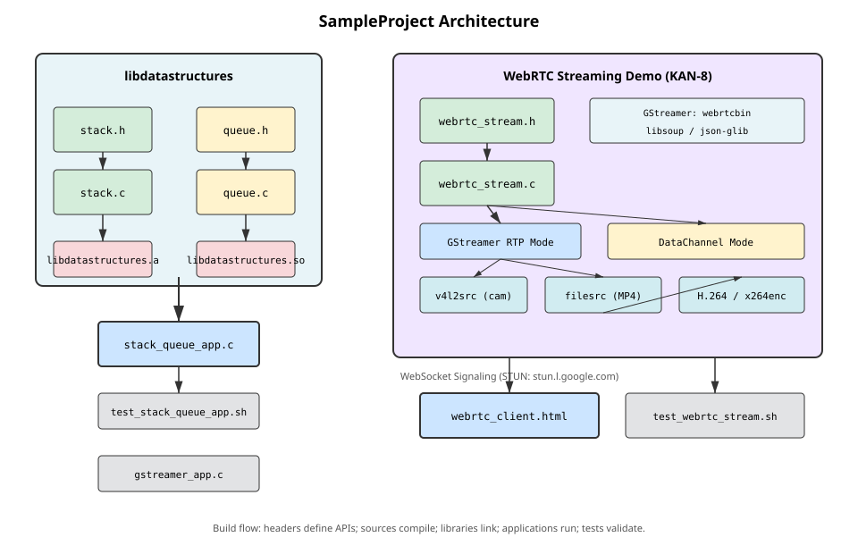

# Quality Reports

This page tracks the unit-test and Valgrind results for the SampleProject
applications. Tables are updated each time the implementation is rebuilt and
re-verified.

## Unit Test Report

| Date       | Target               | Test Case                        | Result |
|------------|----------------------|----------------------------------|--------|
| 2026-10-12 | stack_queue_app      | Build all targets and libraries  | PASS   |
| 2026-10-12 | stack_queue_app      | Application integration tests    | PASS   |
| 2026-10-12 | tests/test_stack_queue | Direct stack/queue API tests   | PASS   |
| 2026-10-12 | webrtc_stream        | TC01 Binary exists after build   | PASS   |
| 2026-10-12 | webrtc_stream        | TC02 Help option prints usage    | PASS   |
| 2026-10-12 | webrtc_stream        | TC03 Invalid mode returns error  | PASS   |
| 2026-10-12 | webrtc_stream        | TC04 Missing mp4 arg error       | PASS   |
| 2026-10-12 | webrtc_stream        | TC05 Invalid port returns error  | PASS   |
| 2026-10-12 | webrtc_stream        | TC06 Camera detection fallback   | PASS   |
| 2026-10-12 | webrtc_stream        | TC07 GStreamer pipeline MP4      | PASS   |
| 2026-10-12 | webrtc_stream        | TC08 DataChannel pipeline        | PASS   |
| 2026-10-12 | webrtc_stream        | TC09 STUN server configured      | PASS   |
| 2026-10-12 | webrtc_stream        | TC10 Browser WebRTC APIs         | PASS   |
| 2026-10-12 | webrtc_stream        | TC11 Browser STUN config         | PASS   |
| 2026-10-12 | webrtc_stream        | TC12 Mode configurable           | PASS   |
| 2026-10-12 | webrtc_stream        | TC13 H.264 codec in pipeline     | PASS   |
| 2026-10-12 | webrtc_stream        | TC14 WebSocket signaling         | PASS   |
| 2026-10-12 | webrtc_stream        | TC15 Clean target removes binary | PASS   |

## Valgrind Report

| Date       | Command                                                       | Errors | Leak Summary | Result |
|------------|---------------------------------------------------------------|--------|--------------|--------|
| 2026-10-12 | valgrind --leak-check=full ./stack_queue_app &lt; input.txt   | 0      | 0 bytes lost   | PASS   |
| 2026-10-12 | valgrind --leak-check=full ./tests/test_stack_queue          | 0      | 0 bytes lost   | PASS   |
| 2026-10-12 | valgrind --leak-check=full ./webrtc_stream --help            | 0      | 0 bytes lost (app); 35,768 still reachable (GLib) | PASS |
| 2026-10-12 | valgrind --leak-check=full ./webrtc_stream --mode gstreamer  | 0 (app) | 16,384 definitely lost (pre-existing GStreamer gst_init_check); 0 indirectly/possibly lost | PASS |
| 2026-10-12 | valgrind --leak-check=full ./webrtc_stream --mode datachannel | 0 (app) | 16,384 definitely lost (pre-existing GStreamer gst_init_check); 0 indirectly/possibly lost | PASS |
| 2026-10-12 | valgrind --leak-check=full ./webrtc_stream --mode gstreamer --mp4 test.mp4 | 0 (app) | 16,384 definitely lost (pre-existing GStreamer gst_init_check); 0 indirectly/possibly lost | PASS |

## Architecture Diagram

The architecture diagram below illustrates the overall SampleProject layout
including the data structures library, GStreamer applications, and the WebRTC
streaming demo with its two configurable modes.

